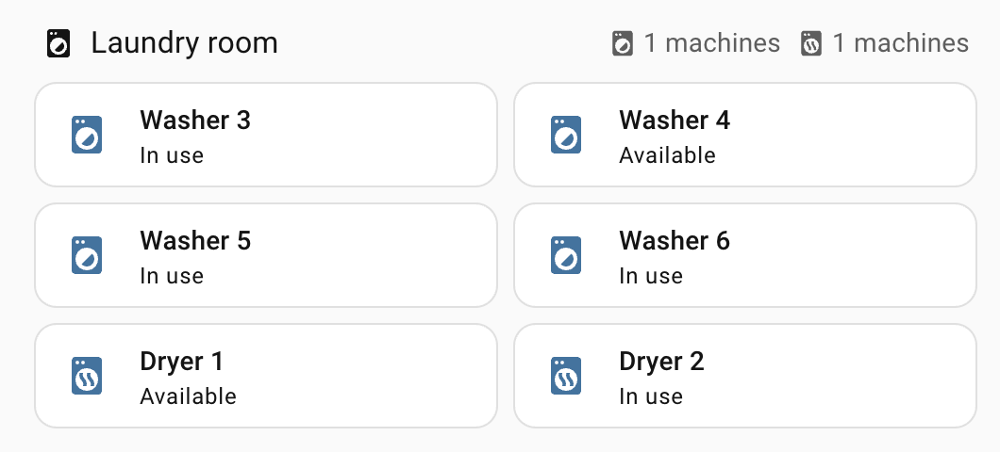

# Airwallet Laundry for Home Assistant


Unofficial Home Assistant integration for [Airwallet](https://www.airwallet.net/) shared laundry rooms.
Get a notification when your wash is done, or when a washing machine is free.

> [!IMPORTANT]
> **Unofficial.** This project is not made, supported or endorsed by Airwallet. Airwallet has no public API:
> this integration uses the same Firebase backend as the Airwallet iOS app (found by looking at the app's own
> network traffic, app v5.2.0). It logs in with **your own account** and **only reads** the status of your
> laundry room and your own orders. It never starts machines or pays for anything.
> It can stop working at any time when Airwallet changes their app. Use it at your own risk.



## What you get

For each machine:

| Entity | Meaning |
|---|---|
| `sensor.<machine>_status` | `available`, `in_use`, `mine` (you started it) or `maintenance` |
| `sensor.<machine>_busy_until` | When the machine is free again (empty when free) |
| `binary_sensor.<machine>_running` | On while the machine is in use |

For the laundry room:

| Entity | Meaning |
|---|---|
| `sensor.<room>_free_washers` / `_free_dryers` | Number of free machines |
| `binary_sensor.<room>_my_laundry_running` | On while one of your machines runs |

Events (for automations):

- `airwallet_machine_started` — a machine was paid and started
- `airwallet_machine_finished` — a machine stopped. `mine: true` when it was your wash.

Event data: `location_id`, `machine_id`, `name`, `product_type`, `mine`.

## How the status works

Each machine has a "busy until" time (`last_used`). When someone pays, it is set to the paid maximum
(for example 180 minutes). When the wash really stops, the Airwallet box sets it to the real end time.
The integration polls every 60 seconds, so a "done" notification comes within about 1 minute.

## Install

1. **With HACS:** HACS → ⋮ → **Custom repositories** → add `https://github.com/martijnvanonz/airwallet-ha`
   with type **Integration**, then download **Airwallet Laundry**.
   **Without HACS:** copy `custom_components/airwallet` to `<config>/custom_components/airwallet`.
2. Restart Home Assistant.
3. **Settings → Devices & services → Add integration → Airwallet Laundry.**
4. Enter your phone number (`+316...`) and the 4-digit PIN of the Airwallet app.
   Leave the laundry room ID empty to use your favorite laundry room.

## Notifications

See [`examples/automations.yaml`](examples/automations.yaml):

- **My wash is done** — triggers on `airwallet_machine_finished` with `mine: true`.
- **A washer is free** — turn on the `input_boolean.wait_for_washer` helper when you want a machine;
  you get one notification when a washer is free, then the helper turns off.

## Check the login outside Home Assistant

```bash
python3 -m venv .venv && .venv/bin/pip install aiohttp
.venv/bin/python scripts/check_login.py
```

## Privacy

The PIN is stored in the Home Assistant config entry (like all integration credentials).
The integration only reads your laundry room and your 10 newest orders.

## Development

```bash
python -m pytest
```

Releases are automatic: raise `version` in `custom_components/airwallet/manifest.json` and push to `main`.

## License

[MIT](LICENSE). Airwallet is a trademark of its owner; this project is not affiliated with it.
